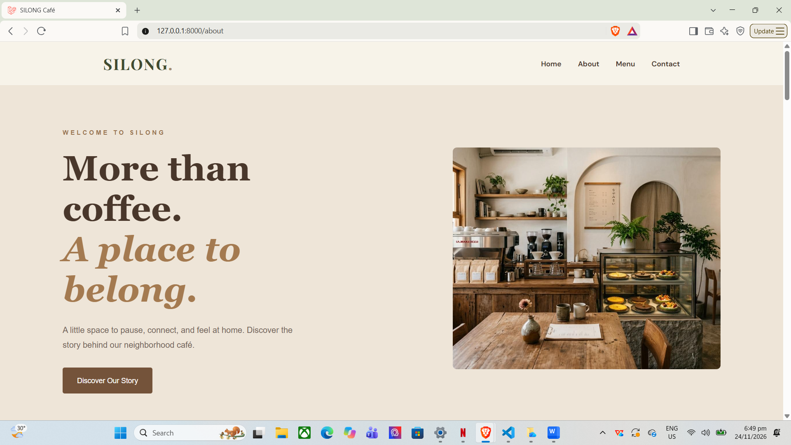
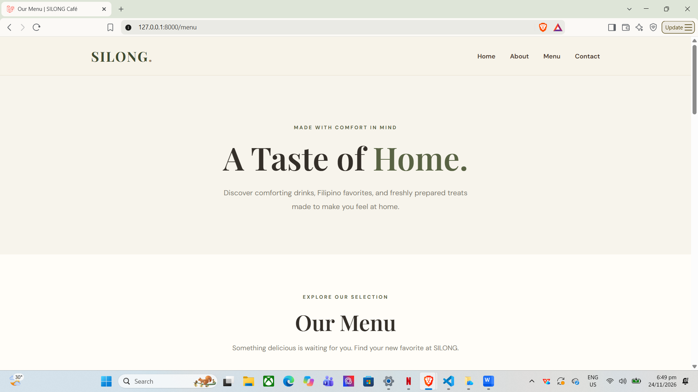

# SILONG Café

**A little space to feel at home.**

 Project Description

SILONG Café is a Laravel-based website for a fictional modern Filipino neighborhood café located in Ampayon, Butuan City, near Caraga State University.

The website introduces the café, showcases its menu, presents its atmosphere, and provides contact information. It aims to create a warm and welcoming online experience for customers.

 Group Information

- Section: AIGO1
- Project: SILONG Café
- Framework: Laravel
- Languages: HTML, CSS, JavaScript, PHP

 Group Members and Responsibilities

| Member | Name | Responsibility | Branch |
|---|---|---|---|
| Member 1 | Noval | Home Page / Group Leader | `dev-member1-Noval` |
| Member 2 | Negros | About Page | `dev-member2-Negros` |
| Member 3 | Pacquiao | Menu Page | `dev-member3-Pacquiao` |
| Member 4 | Presillas | Contact Page | `dev-member4-Presillas` |

 Website Pages

1. Home – Introduces SILONG Café, its featured menu, and atmosphere.
2. About – Presents the café's story, mission, vision, values, and team.
3. Menu – Displays coffee, non-coffee drinks, Filipino favorites, pastries, and meals.
4. Contact – Provides café information and a contact form.

 Main Features

- Shared navigation and footer
- Responsive website layout
- Interactive home page image slider
- About page Read More and Read Less feature
- Menu category filters
- Contact form validation

 Installation and Setup

 Requirements

- PHP
- Composer
- Laravel
- Git

 Steps

1. Clone the repository:

   ```bash
   git clone https://github.com/novalrajhenne-dot/Lara-Proj-AIGO1-Noval-Presillas-Negros-Pacquiao.git
   ```

2. Enter the project folder:

   ```bash
   cd Lara-Proj-AIGO1-Noval-Presillas-Negros-Pacquiao
   ```

3. Install dependencies:

   ```bash
   composer install
   ```

4. Create your environment file:

   ```bash
   copy .env.example .env
   ```

5. Generate the application key:

   ```bash
   php artisan key:generate
   ```

6. Run database migrations:

   ```bash
   php artisan migrate
   ```

7. Start the Laravel development server:

   ```bash
   php artisan serve
   ```

8. Open the website in your browser:

   `http://127.0.0.1:8000`

 Collaboration Workflow

- Each member works on their assigned branch.
- Each member makes at least five meaningful commits.
- Members push their work to their own branches.
- Members create Pull Requests to the `main` branch.
- The group leader reviews and merges Pull Requests.
- Do not commit `.env` or the `vendor` folder.

 Repository

[GitHub Repository](https://github.com/novalrajhenne-dot/Lara-Proj-AIGO1-Noval-Presillas-Negros-Pacquiao)

 Screenshots

 Home Page


 About Page


 Menu Page


 Contact Page


 Project Theme

SILONG Café uses a warm, minimalist, and Filipino-inspired design. Its color palette includes olive green, warm cream, beige, and brown to create a welcoming and relaxing café atmosphere.