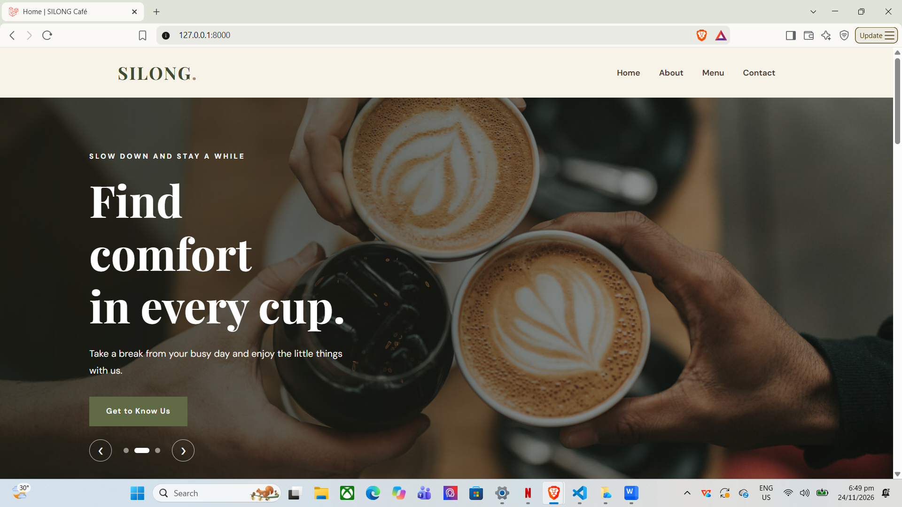
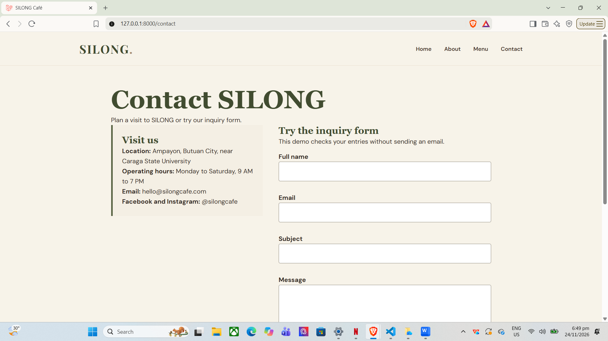

SILONG Café

A little space to feel at home.

Project Description

SILONG Café is a Laravel-based website for a fictional modern Filipino neighborhood café located in Ampayon, Butuan City, near Caraga State University.

The website introduces the café, showcases its menu, shares information about the café, and provides contact information for customers. It aims to create a warm, welcoming, and comfortable online experience.

Group Information

- Section: AIGO1
- Project Name: SILONG Café
- Framework: Laravel
- Languages: HTML, CSS, JavaScript, PHP

Group Members and Responsibilities

| Member | Name | Responsibility |
|---|---|---|
| Member 1 | Noval | Home Page and Group Leader |
| Member 2 | Negros | About Page |
| Member 3 | Pacquiao | Menu Page |
| Member 4 | Presillas | Contact Page |

Website Pages

1. Home – Introduces SILONG Café and highlights its featured products and welcoming atmosphere.
2. About – Presents the café's background and information.
3. Menu – Displays the café's food and beverages.
4. Contact – Provides café information and a contact form.

Main Features

- Shared navigation bar and footer
- Responsive website layout
- Interactive Home page image slider
- Café information and menu presentation
- Contact form validation
- Consistent visual design across pages

Project Theme and Design

SILONG Café uses a warm, minimalist, and Filipino-inspired design.

The color palette includes:
- Olive green
- Warm cream
- Muted brown
- Off-white
- Soft beige

The design uses serif headings, clean sans-serif text, café photography, and simple layouts to create a welcoming atmosphere.

Project Structure

```text
project-folder/
├── app/
├── public/
│   ├── css/
│   ├── js/
│   └── images/
├── resources/
│   └── views/
│       └── layouts/
├── routes/
│   └── web.php
├── database/
├── .env.example
├── composer.json
└── README.md
```

Installation and Setup

Requirements

- PHP
- Composer
- Laravel
- Git

Steps

1. Clone the repository:

```bash
git clone https://github.com/novalrajhenne-dot/Lara-Proj-AIGO1-Noval-Presillas-Negros-Pacquiao.git
```

2. Enter the project folder:

```bash
cd Lara-Proj-AIGO1-Noval-Presillas-Negros-Pacquiao
```

3. Install dependencies:

```bash
composer install
```

4. Create the environment file:

```bash
copy .env.example .env
```

5. Generate the application key:

```bash
php artisan key:generate
```

6. Run database migrations if required:

```bash
php artisan migrate
```

7. Start the development server:

```bash
php artisan serve
```

8. Open the website:

```text
http://127.0.0.1:8000
```

Branching and Collaboration Workflow

- Each member works on their assigned Git branch.
- Each member makes at least five meaningful commits, following the project instructions.
- Members push their changes to their respective branches.
- Members create Pull Requests targeting the `main` branch.
- The group leader reviews and merges Pull Requests.
- Members coordinate to ensure that all pages work together.
- The `.env`, `vendor`, and other excluded files should not be committed.

GitHub Repository

[View the SILONG Café Repository](https://github.com/novalrajhenne-dot/Lara-Proj-AIGO1-Noval-Presillas-Negros-Pacquiao)

Screenshots

Home Page


About Page


Menu Page


Contact Page

License

This project was developed as a group academic activity.
